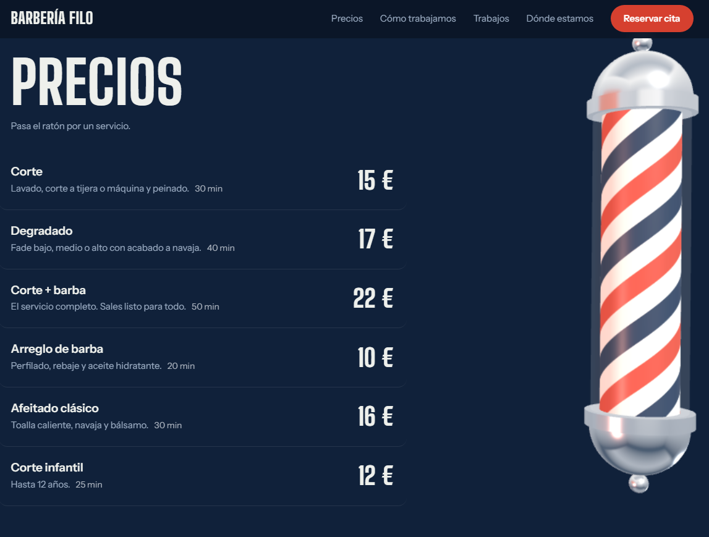
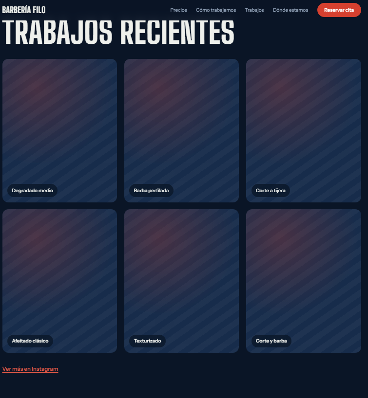

# Barbería Filo 3D — Tema de WordPress con Three.js

Versión inmersiva del tema [Barbería Filo](../tema-wp-barberia-filo): un **poste de barbero en 3D hecho con Three.js** que gira y reacciona al **scroll** y al **movimiento del ratón**.

## Capturas

| | |
|---|---|
|  |  |
|  |  |

## Características
- Escena 3D en **JavaScript** (`assets/js/escena.js`) con **Three.js** integrada en un tema de **WordPress** desarrollado a medida en **PHP**.
- Animación ligada al scroll y a la posición del puntero.
- Paleta sacada del propio poste (azul marino, rojo esmalte, blanco) definida en variables CSS.
- Datos del negocio centralizados en `inc/datos.php`.
- Diseño **responsive**.

## Instalación
Copiar en `wp-content/themes/`, activar y editar `inc/datos.php`. WordPress 6.0+, PHP 7.4+.

---
Rafael Izquierdo · KizaryDev
